# Lotería Push 🎴

Juego de Lotería mexicana con **notificaciones push (Firebase Cloud Messaging)**. El servidor en Node (`server/`) es el cantor: maneja la sala, las reglas y envía los push; la app en Flutter (`app/`) recibe las cartas y marca la tabla.

Proyecto hecho con **TDD** (primero la prueba en rojo, luego el código para ponerla en verde) siguiendo el manual de la materia.

## Cómo correr las pruebas

```
cd app
flutter test
```

Pruebas del servidor:

```
cd server
node --test
```

> Para correr la app en el celular falta conectar un proyecto de Firebase con `flutterfire configure` (genera `app/lib/firebase_options.dart`).

---

## Evidencias TDD (rojo → verde)

**Alumna:** Yaneli Sánchez Cárdenas · **Grupo:** GTID244

Cada ronda muestra primero la prueba en **rojo** (falla porque el código todavía no existe) y después en **verde** (pasa ya con el código hecho).

### Ronda 1

**🔴 Rojo — la prueba falla**

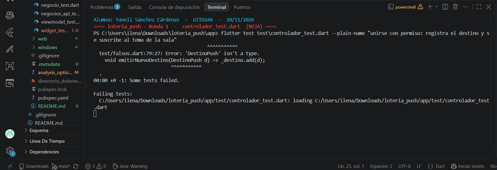

**🟢 Verde — la prueba pasa**

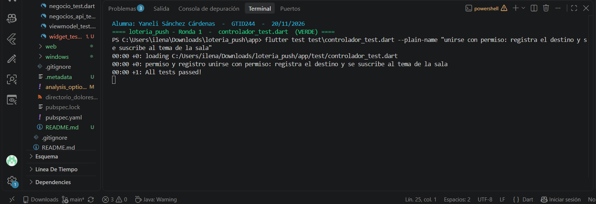

### Ronda 2

**🔴 Rojo — la prueba falla**

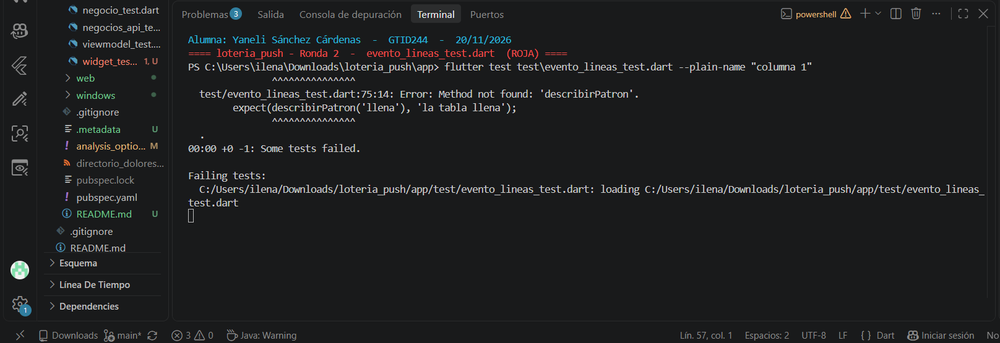

**🟢 Verde — la prueba pasa**

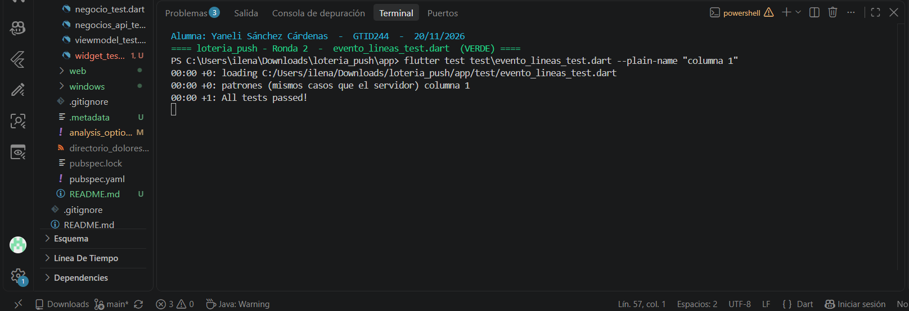

### Ronda 3

**🔴 Rojo — la prueba falla**

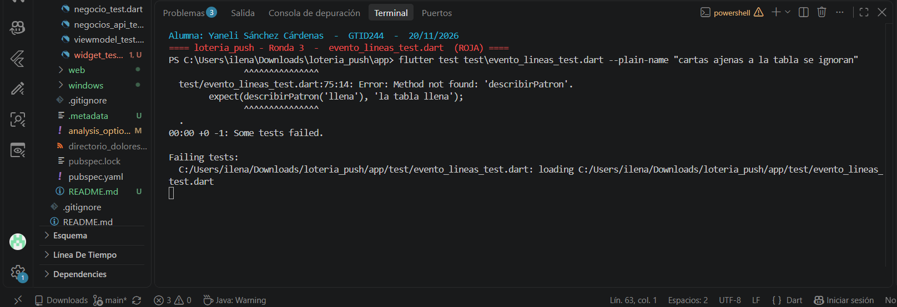

**🟢 Verde — la prueba pasa**

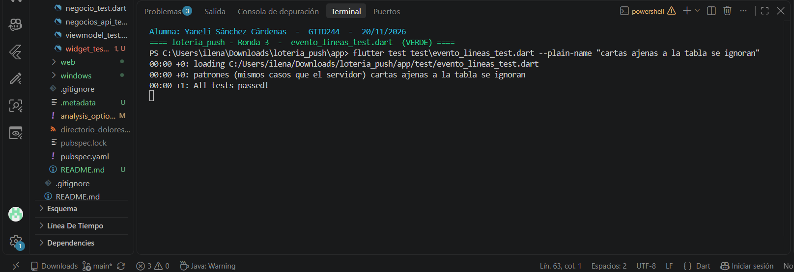

### Ronda 4

**🔴 Rojo — la prueba falla**

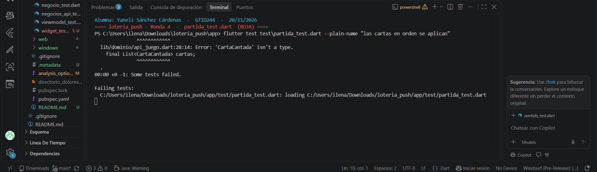

**🟢 Verde — la prueba pasa**

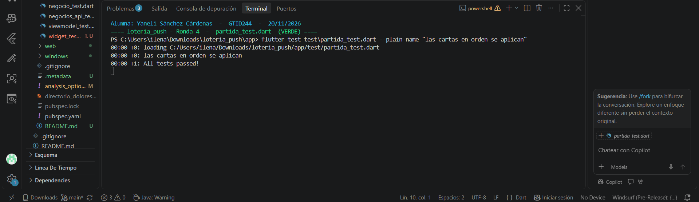

### Ronda 5

**🔴 Rojo — la prueba falla**

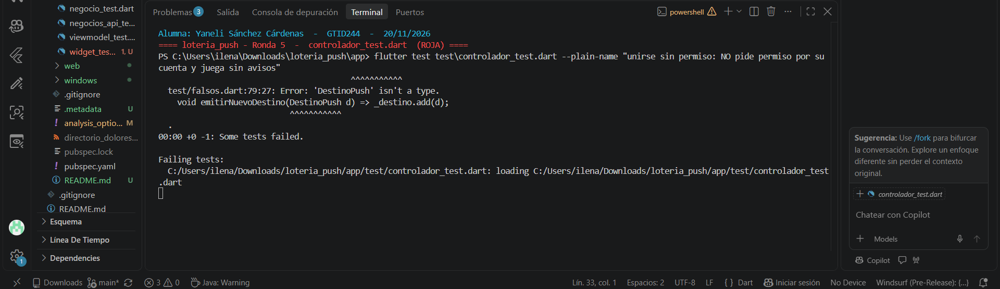

**🟢 Verde — la prueba pasa**


### Ronda 6

**🔴 Rojo — la prueba falla**

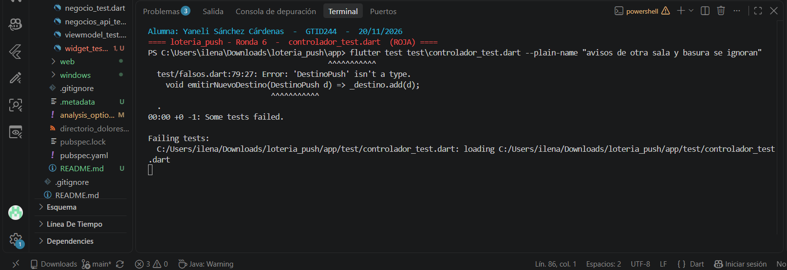

**🟢 Verde — la prueba pasa**

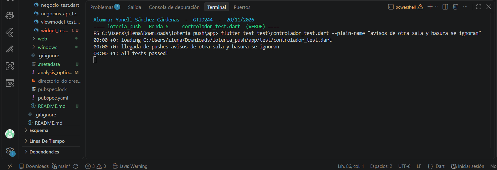

### Ronda 7

**🔴 Rojo — la prueba falla**

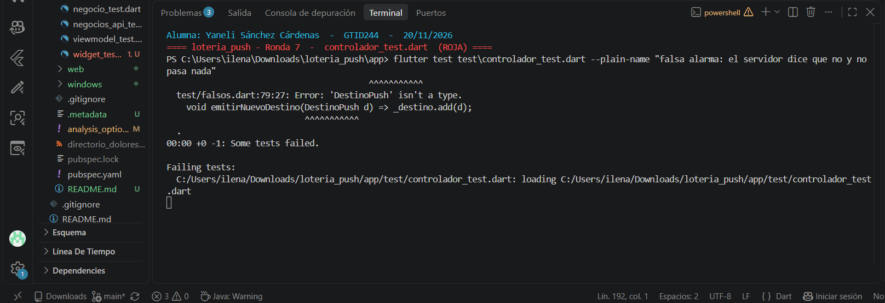

**🟢 Verde — la prueba pasa**

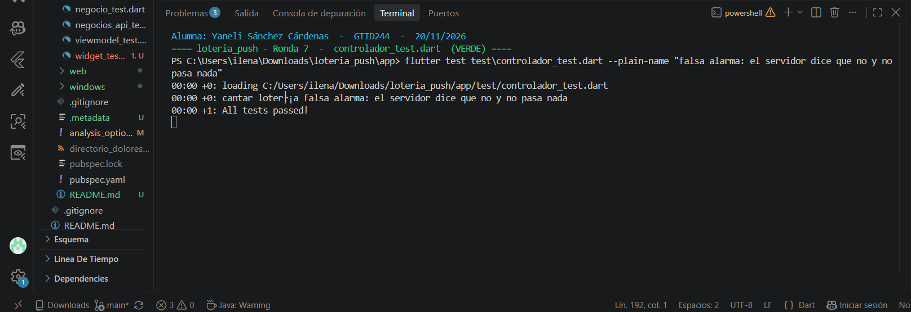

### Ronda 8

**🔴 Rojo — la prueba falla**

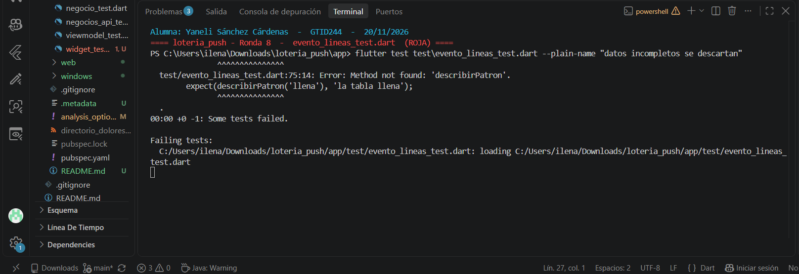

**🟢 Verde — la prueba pasa**

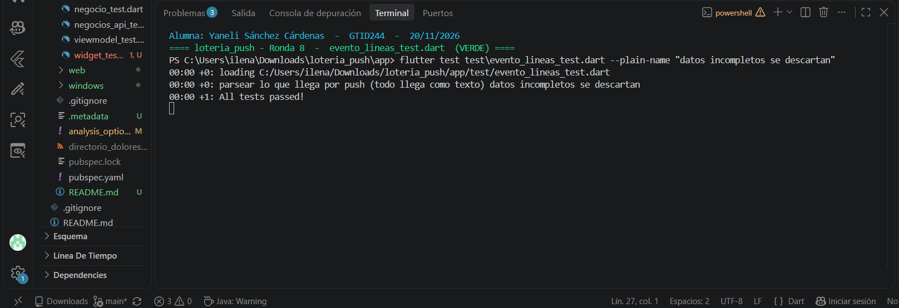
